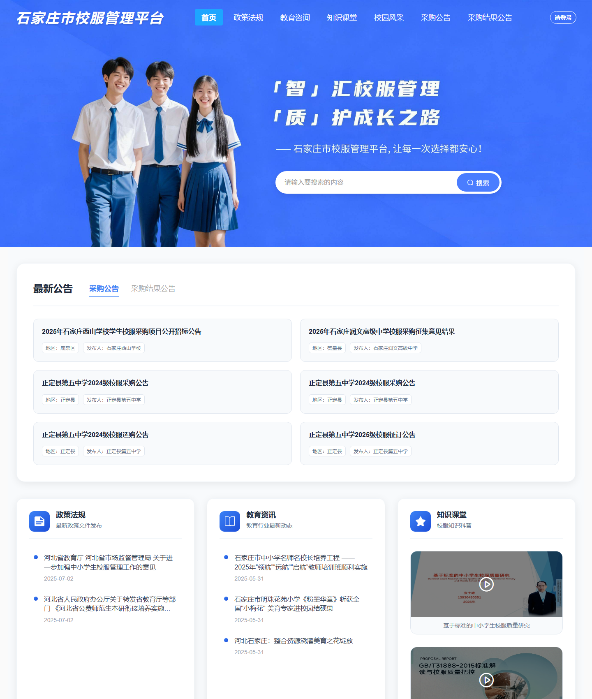
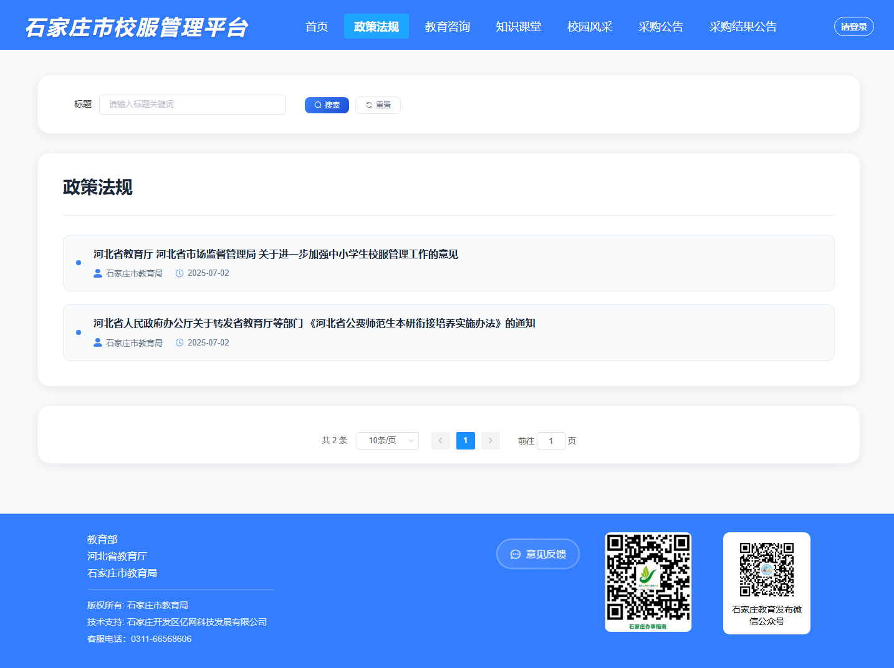
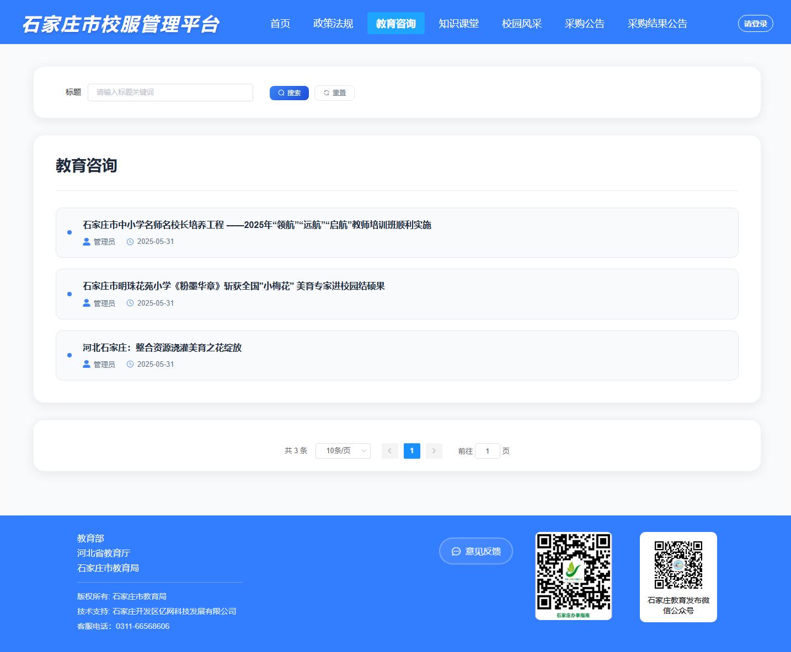
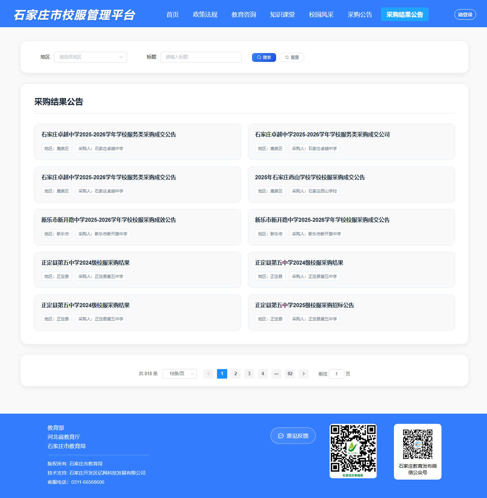
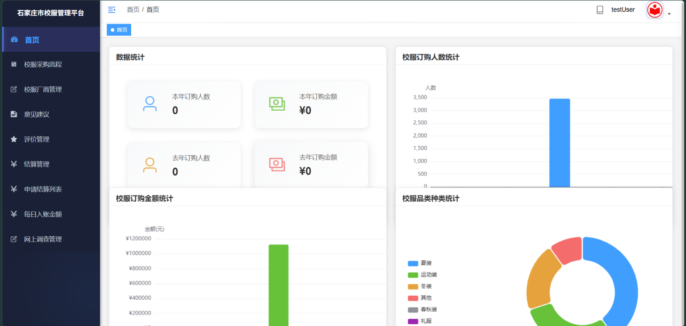
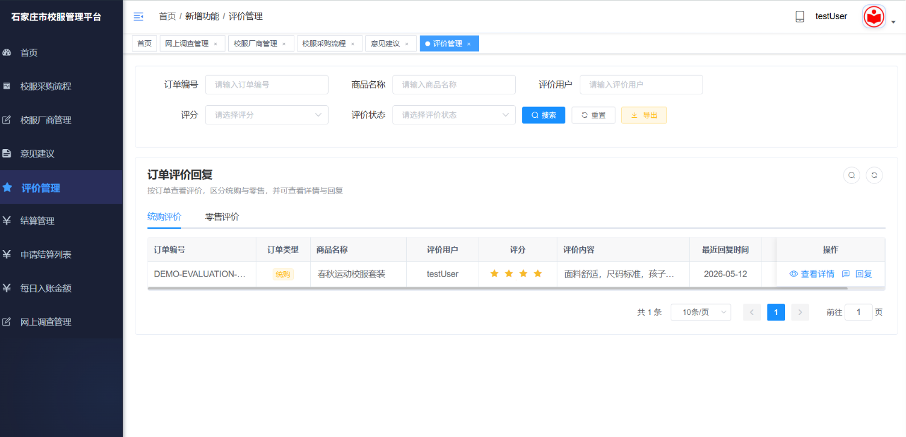

# 石家庄市校服管理平台

面向教育主管部门、学校、校服供应商和家长的校服管理平台。仓库包含管理后台、家长端应用、微服务后端以及数据库脚本和设计资料。

## 页面截图

以下截图来自本地运行的 PC 端公开首页。




### 政策法规



### 教育咨询



### 采购结果公告



### PC 管理后台






## 仓库目录结构

```text
school-uniform-platform/
|-- README.md
|-- screenshots/                              # README 中使用的页面截图
|-- 经贸大学校服项目/
|   `-- xfpt/                                 # Java 后端 Maven 工程
|       |-- xfglpt-auth/                      # 登录认证与令牌
|       |-- xfglpt-gateway/                   # API 网关
|       |-- xfglpt-api/xfglpt-api-system/      # 微服务间 API 接口
|       |-- xfglpt-common/                    # 公共组件与基础能力
|       |-- xfglpt-modules/
|       |   |-- xfglpt-system/                # 用户、角色、菜单与系统管理
|       |   |-- xfglpt-shcool/                # 学校业务（目录名沿用项目拼写）
|       |   |-- xfglpt-supplier/              # 供应商业务
|       |   |-- xfglpt-app/                   # 家长端接口
|       |   |-- xfglpt-file/                  # 文件服务
|       |   |-- xfglpt-gen/                   # 代码生成
|       |   `-- xfglpt-job/                   # 定时任务
|       |-- xfglpt-visual/xfglpt-monitor/      # 服务监控
|       |-- docker/                           # Docker 部署配置
|       |-- sql/                              # 后端初始化 SQL
|       |-- docs/                             # 本地启动及开发文档
|       `-- bin/                              # Windows 打包和启动脚本
|-- xiaofu-PC端/
|   `-- xiaofu-xx/                            # Vue PC 管理后台
|       |-- public/                           # 静态入口资源
|       |-- src/
|       |   |-- api/                          # 后端 API 封装
|       |   |-- components/                   # 公共组件
|       |   |-- layout/                       # 后台布局
|       |   |-- router/                       # 页面路由
|       |   |-- store/                        # Vuex 状态管理
|       |   `-- views/                        # 登录、门户和业务页面
|       |-- package.json
|       `-- vue.config.js
|-- xiaofu-手机端/
|   `-- xiaofu-jiazhang/                      # uni-app 家长端
|       |-- pages/                            # H5、小程序页面
|       |-- api/                              # 接口封装
|       |-- config/                           # 环境配置
|       |-- static/                           # 图片等静态资源
|       |-- uni_modules/                      # uni-app 扩展模块
|       |-- manifest.json                     # 应用及平台配置
|       `-- pages.json                        # 页面和导航配置
|-- 修改数据库/
|   |-- 新增表sql脚本/                        # 新业务表脚本
|   `-- 对原来的数据库修改的sql脚本/          # 已有表升级脚本
|-- 数据库备份/                               # 数据库备份文件
|-- 数据库导出/                               # 数据库导出文件
|-- sql/                                      # 仓库级补充 SQL
`-- 业务扩充数据库设计说明-完整版(1).md
```

## 主要组件和技术

| 目录 | 说明 | 主要技术 |
| --- | --- | --- |
| `经贸大学校服项目/xfpt` | 后端微服务工程 | Java 8、Spring Boot 2.7、Spring Cloud Alibaba、MyBatis Plus |
| `xiaofu-PC端/xiaofu-xx` | PC 管理后台与公开门户 | Vue 2、Vue CLI 4、Element UI |
| `xiaofu-手机端/xiaofu-jiazhang` | 家长端，支持 H5、微信小程序和 App 构建 | uni-app、Vue 2 |
| `修改数据库`、`数据库备份`、`数据库导出` | 业务 SQL、升级脚本及数据库资料 | MySQL |

后端服务包括认证、系统管理、学校、供应商、家长端接口、文件、代码生成、定时任务、监控和 API 网关。各服务端口及推荐启动顺序见下文。

## 开发环境

- Java 8 和 Maven
- Node.js、npm（PC 端依赖版本见 `xiaofu-PC端/xiaofu-xx/package.json`）
- MySQL、Redis、Nacos
- HBuilderX（运行或发行 uni-app 家长端时使用）

后端本地启动说明和 IDEA 配置清单见 [`经贸大学校服项目/xfpt/docs/IDEA本地启动说明.md`](经贸大学校服项目/xfpt/docs/IDEA本地启动说明.md)。首次启动前，请按当前环境检查各服务的 Nacos、数据库和 Redis 配置；不要直接使用生产环境地址或凭据。

## 本地启动

### 1. 准备基础服务

启动 MySQL、Redis 和 Nacos，并根据各服务配置创建或导入所需数据库。SQL 资料位于 [`经贸大学校服项目/xfpt/sql`](经贸大学校服项目/xfpt/sql) 和 [`修改数据库`](修改数据库)；备份与导出文件位于对应目录。导入前请先确认脚本适用的数据库版本和目标库，避免覆盖已有数据。

### 2. 启动后端

用 IDEA 打开 `经贸大学校服项目/xfpt` 并导入 Maven 工程。根据本机环境检查 Nacos、MySQL、Redis 连接配置，再启动所需服务。推荐顺序如下：

1. 认证服务 `xfglpt-auth`（9200）和系统服务 `xfglpt-system`（9201）
2. 文件服务 `xfglpt-file`（9300）
3. 学校服务 `xfglpt-shcool`（9204）、供应商服务 `xfglpt-supplier`（9211）和家长端接口 `xfglpt-app`（9206）
4. 网关 `xfglpt-gateway`（8080）

按需启动代码生成服务 `xfglpt-gen`（9202）、定时任务服务 `xfglpt-job`（9203）和监控服务 `xfglpt-monitor`（9100）。

### 3. 启动 PC 管理后台

```powershell
cd xiaofu-PC端/xiaofu-xx
npm ci
npm run dev
```

开发服务器默认端口为 80，API 代理目标为 `http://127.0.0.1:8080`。如本机端口已占用，可通过 `npm_config_port` 指定其他端口。开发环境 API 前缀和其他地址配置见 `.env.development`。

构建命令：`npm run build:prod`。提交前可运行 `npm run lint`。

### 4. 运行家长端

使用 HBuilderX 打开 `xiaofu-手机端/xiaofu-jiazhang`，在项目配置中设置后端 API 地址，然后选择 H5、微信小程序或 App 运行/发行。该目录没有独立的 npm 启动脚本；H5 和小程序的页面、路由及应用配置分别见 `pages.json` 与 `manifest.json`。

## 数据库资料

- 基础表和若依平台初始化脚本：`经贸大学校服项目/xfpt/sql`
- 业务表创建、升级和代码生成器相关脚本：`修改数据库`
- 表结构说明：[`修改数据库/20张业务表说明文档.md`](修改数据库/20张业务表说明文档.md) 和 [`修改数据库/数据库表分析.md`](修改数据库/数据库表分析.md)
- 数据备份与导出：`数据库备份`、`数据库导出`

建议先阅读升级说明和表结构文档，再在备份或测试数据库中执行 SQL。不要把备份脚本直接导入已有生产数据库。

## 配置与安全

各微服务的数据源、Redis、Nacos 和文件存储配置在后端各模块的 `src/main/resources` 下；PC API 地址在对应 `.env.*` 文件中；家长端 API 配置位于其 `config` 目录。请使用本地或部署环境专用配置管理地址、账号、密钥和域名，不要将真实凭据提交到版本库。

## 许可证

后端基于若依微服务项目二次开发，相关许可见 [`经贸大学校服项目/xfpt/LICENSE`](经贸大学校服项目/xfpt/LICENSE)。前后端及第三方依赖各自的许可条款仍需分别遵守。
