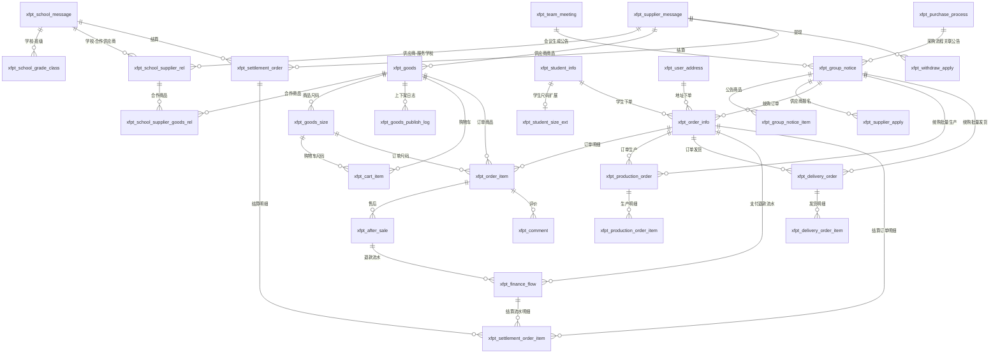

# 校服平台业务扩充数据库设计说明（完整版）

## 1. 文档目标

本文档按“**Excel 中功能全部要能真正实现**”的标准，给出一套完整数据库设计方案。

本方案遵循以下原则：

- 尽量复用现有业务表，不推翻已上线流程。
- 原则上不修改旧业务表结构，新增表兼容旧表。
- 对必须独立落库的模块单独建表，不用 JSON 硬扛业务流程。
- 优先保证学校端、供应商端、家长端、教育局端四类角色的功能完整闭环。

## 2. 设计结论

按当前“完整版”方案，建议：

- **复用旧业务表：35 张**
- **新增新业务表：23 张**
- **业务相关表合计：58 张**
- **另依赖平台基础表：若干张**

> 说明：这里统计的是“本次业务扩充真正会用到的业务表”，不包含所有基础权限表、日志表、定时任务表。

## 3. 依赖的基础平台表

以下表不是本次重点设计对象，但业务实现会依赖它们：

| 表名 | 用途 |
|---|---|
| `sys_user` | 平台登录用户 |
| `sys_role` | 角色定义 |
| `sys_user_role` | 用户角色关系 |
| `sys_dept` | 部门/学校/教育局组织树 |
| `sys_file` | 文件上传后的资源记录 |
| `sys_notice` | 平台级通知 |

### 3.1 真实库字段校验结论

已按当前 `xfglpt` 业务库校验旧表和平台基础表，落库时必须注意以下真实字段口径：

- 4.1 到 4.4 中列出的 35 张旧业务表当前均存在。
- 大多数旧业务表主键物理字段为大写 `ID`，例如 `xfpt_school_message.ID`、`xfpt_student_info.ID`、`xfpt_supplier_message.ID`。
- 平台表主键不是统一 `id`：`sys_user.USER_ID`、`sys_dept.DEPT_ID`、`sys_notice.NOTICE_ID`、`sys_file.ID`。
- `xfpt_notic_user` 当前无主键，新增表不要直接依赖它做强外键。
- `xfpt_student_info` 中学校字段为历史字段 `SHCOOL_ID`，不是 `school_id`；新增表如果要冗余学校 ID，应从学生绑定关系或订单上下文中明确取值。

## 4. 复用旧业务表清单

### 4.1 学校与人员基础信息

| 表名 | 作用 | 对应功能 |
|---|---|---|
| `xfpt_school_message` | 学校基础信息 | 学校信息设置、学校信息统计 |
| `xfpt_school_grade_class` | 学校年级班级 | 年级班级管理 |
| `xfpt_buy_grade_class` | 采购涉及的年级班级 | 采购年级范围、会议采购需求 |
| `xfpt_student_info` | 家长绑定学生信息 | 家长端学生列表、添加、详情、编辑 |
| `xfpt_sim_user` | 外部家长/市民身份映射 | 家长身份关联、问卷与学生绑定 |
| `xfpt_supplier_message` | 供应商基础信息 | 厂商信息、厂商管理、厂商信息编辑 |
| `xfpt_hmd` | 供应商黑名单 | 教育局黑名单管理、学校选供应商校验 |

### 4.2 采购规范流程与报备

| 表名 | 作用 | 对应功能 |
|---|---|---|
| `xfpt_team_meeting` | 班子会议纪要主表 | 班子会议纪要报备 |
| `xfpt_team_meeting_son` | 班子会议纪要明细 | 采购需求明细、采购年级、品类、件数 |
| `xfpt_jz_buy_opinions` | 家长购买意见征集主表 | 家长购买意见征集管理 |
| `xfpt_jz_buy_opinions_son` | 家长购买意见征集明细 | 征集范围、采购年级明细 |
| `xfpt_org_report_disclose` | 选用组织名单主表 | 选用组织名单报备 |
| `xfpt_org_report_disclose_son` | 选用组织成员明细 | 选用组织成员列表 |
| `xfpt_report_mode` | 选购模式报备主表 | 选用组织确定选购模式报备 |
| `xfpt_report_mode_oper` | 选购模式操作记录 | 选购模式操作轨迹 |
| `xfpt_parent_mode` | 家长参与模式 | 家长参与选购模式 |
| `xfpt_organization_mode` | 选用组织自主确定企业模式 | 自主模式发布选购信息 |
| `xfpt_yxwf_mode` | 其他模式/意向问卷模式 | 选购流程相关补充模式 |
| `xfpt_enterprise_mode` | 委托招标机构确定企业模式 | 招标模式、撤回、发布 |
| `xfpt_anno_results` | 选购结果公示报备与公开 | 发布选购结果、成交公告 |
| `xfpt_purchase_process` | 采购流程主记录 | 学校采购流程状态跟踪 |
| `xfpt_proc_summary` | 采购信息汇总 | 采购信息汇总、流程统计 |

### 4.3 合同、质检、供应商结果

| 表名 | 作用 | 对应功能 |
|---|---|---|
| `xfpt_supplier_list` | 确定供应商名单 | 比选后中选企业列表 |
| `xfpt_supplice_contract` | 学校采购合同主表 | 合同管理、添加合作厂商 |
| `xfpt_supplice_contract_son` | 学校采购合同明细/附件 | 查看合同、合同文件、商品合同明细 |
| `xfpt_supplice_inspection_report` | 质检报告主表 | 学校质检、供应商质检、质检统计 |
| `xfpt_supplice_inspection_report_son` | 质检报告附件/明细 | 查看、上传质量检验报告 |

### 4.4 满意度、问卷、反馈、内容发布

| 表名 | 作用 | 对应功能 |
|---|---|---|
| `xfpt_patriarch_satisfaction_summarize` | 家长满意度总结报告 | 满意度总结报备与公开 |
| `xfpt_questionnaire_config` | 问卷主配置 | 新建、编辑、预览、删除问卷 |
| `xfpt_questionnaire_survey` | 问卷题目明细 | 问卷题目配置 |
| `xfpt_questionnaire_result` | 问卷作答结果 | 问卷数据、参与调查、结果查看 |
| `xfpt_questionnaire_signature` | 问卷签名信息 | 签名确认类问卷 |
| `xfpt_parents_feedback` | 家长意见反馈 | 意见建议、我的反馈 |
| `xfpt_notice` | 内容发布/公告 | 政策内容发布、学校公告、成交公告对外展示 |
| `xfpt_notic_user` | 公告已读关系 | 用户公告阅读记录 |

## 5. 新增业务表清单

下面 23 张表是“完整实现 Excel 功能”时建议新增的表。

## 6. 新增表设计明细

### 6.1 商品中心

#### 6.1.1 `xfpt_goods`

**用途**

- 商品库管理
- 零售商品管理
- 统购可选商品基础信息

**核心字段建议**

| 字段 | 说明 |
|---|---|
| `id` | 主键 |
| `goods_name` | 商品名称 |
| `goods_code` | 商品编码 |
| `category_name` | 品类名称 |
| `supplier_id` | 关联 `xfpt_supplier_message.ID` |
| `supplier_name` | 供应商名称快照 |
| `brand_name` | 品牌名 |
| `main_image` | 主图 |
| `detail_images_json` | 详情图片 JSON |
| `detail_content` | 商品详情 |
| `sale_type` | `1统购 2零售 3统购零售` |
| `status` | `0草稿 1启用 2停用` |
| `publish_status` | `0未上架 1已上架 2已下架` |
| `publish_time` | 上架时间 |
| `off_shelf_time` | 下架时间 |

**能做的功能**

- 商品库列表、新增、修改、删除
- 零购商品上架、下架、详情
- 学校或供应商选择商品参与统购

**关联关系**

- `supplier_id -> xfpt_supplier_message.ID`
- 可通过 `xfpt_school_supplier_goods_rel.goods_id` 关联学校合作商品
- 可通过 `xfpt_group_notice_item.goods_id` 进入统购公告

#### 6.1.2 `xfpt_goods_size`

**用途**

- 商品尺码管理
- 不同尺码价格、库存管理
- 家长端学生尺码匹配

**核心字段建议**

| 字段 | 说明 |
|---|---|
| `id` | 主键 |
| `goods_id` | 关联 `xfpt_goods.id` |
| `size_code` | 尺码编码 |
| `size_name` | 尺码名称 |
| `gender_type` | 男女款区分 |
| `measure_json` | 尺码量体信息 JSON |
| `retail_price` | 零售价 |
| `group_price` | 统购价 |
| `stock_num` | 库存 |
| `status` | 启用禁用 |

**能做的功能**

- 商品尺码管理新增、修改、删除
- 订单按尺码下单
- 尺码库存统计

**关联关系**

- `goods_id -> xfpt_goods.id`
- `order_item.size_id -> xfpt_goods_size.id`
- `student_size_ext.size_id -> xfpt_goods_size.id` 可选

#### 6.1.3 `xfpt_goods_publish_log`

**用途**

- 零售商品上下架记录

**核心字段建议**

| 字段 | 说明 |
|---|---|
| `id` | 主键 |
| `goods_id` | 商品 ID |
| `operate_type` | `1上架 2下架` |
| `operate_by` | 操作人 |
| `operate_time` | 操作时间 |
| `remark` | 备注 |

**能做的功能**

- 零售上下架记录列表、详情

**关联关系**

- `goods_id -> xfpt_goods.id`

### 6.2 学校与供应商合作关系

#### 6.2.1 `xfpt_school_supplier_rel`

**用途**

- 学校与供应商合作关系
- 设置服务电话
- 服务学校列表
- 历史服务学校
- 公告期内学校

**核心字段建议**

| 字段 | 说明 |
|---|---|
| `id` | 主键 |
| `school_id` | 学校 ID |
| `supplier_id` | 供应商 ID |
| `service_phone` | 服务电话 |
| `notice_id` | 关联统购公告，可为空 |
| `contract_id` | 关联合同，可为空 |
| `cooperate_status` | `1合作中 2已取消 3历史合作 4公告期内` |
| `start_time` | 开始时间 |
| `end_time` | 结束时间 |

**能做的功能**

- 合作学校管理
- 取消合作
- 设置服务电话
- 服务学校列表

**关联关系**

- `school_id -> xfpt_school_message.ID`
- `supplier_id -> xfpt_supplier_message.ID`
- `contract_id -> xfpt_supplice_contract.ID`
- `notice_id -> xfpt_group_notice.id`

#### 6.2.2 `xfpt_school_supplier_goods_rel`

**用途**

- 学校与供应商的合作商品绑定

**核心字段建议**

| 字段 | 说明 |
|---|---|
| `id` | 主键 |
| `rel_id` | 关联合作关系主表 |
| `school_id` | 学校 ID |
| `supplier_id` | 供应商 ID |
| `goods_id` | 商品 ID |
| `status` | 启用状态 |

**能做的功能**

- 合作学校管理中的“关联商品”
- 学校查看某合作厂商可服务商品

**关联关系**

- `rel_id -> xfpt_school_supplier_rel.id`
- `goods_id -> xfpt_goods.id`

### 6.3 统购公告与报名

#### 6.3.1 `xfpt_group_notice`

**用途**

- 统购公告主表
- 学校发布统购公告

**核心字段建议**

| 字段 | 说明 |
|---|---|
| `id` | 主键 |
| `school_id` | 学校 ID |
| `team_meeting_id` | 关联会议纪要 |
| `purchase_process_id` | 关联采购流程 |
| `title` | 公告标题 |
| `notice_code` | 公告编号 |
| `notice_type` | `1选购公告 2结果公告` |
| `content` | 公告内容 |
| `status` | `0草稿 1已发布 2已结束 3已撤回` |
| `apply_status` | `0未开放 1报名中 2报名结束` |
| `start_time` | 开始时间 |
| `end_time` | 结束时间 |
| `publish_time` | 发布时间 |

**能做的功能**

- 统购公告列表、添加、详情
- 教育局公告统计
- 家长端统购公告展示

**关联关系**

- `school_id -> xfpt_school_message.ID`
- `team_meeting_id -> xfpt_team_meeting.ID`
- `purchase_process_id -> xfpt_purchase_process.ID`

#### 6.3.2 `xfpt_group_notice_item`

**用途**

- 公告下商品明细
- 采购数量、采购范围、价格说明

**核心字段建议**

| 字段 | 说明 |
|---|---|
| `id` | 主键 |
| `notice_id` | 关联公告 |
| `goods_id` | 商品 ID |
| `size_rule_json` | 可选尺码规则 |
| `buy_num` | 参考购买件数 |
| `price_desc` | 价格区间或价格说明 |
| `grade_ids` | 适用年级范围 |
| `remark` | 备注 |

**能做的功能**

- 公告商品配置
- 统购公告详情中的商品展示
- 家长下单的统购商品来源

**关联关系**

- `notice_id -> xfpt_group_notice.id`
- `goods_id -> xfpt_goods.id`

#### 6.3.3 `xfpt_supplier_apply`

**用途**

- 供应商报名
- 资格审查结果列表
- 参与比选环节列表
- 上传比选资料

**核心字段建议**

| 字段 | 说明 |
|---|---|
| `id` | 主键 |
| `notice_id` | 公告 ID |
| `school_id` | 学校 ID |
| `supplier_id` | 供应商 ID |
| `supplier_name` | 供应商名称快照 |
| `apply_no` | 报名单号 |
| `apply_status` | `0待提交 1已提交 2已撤回` |
| `qualification_status` | `0待审查 1通过 2不通过` |
| `bid_stage_status` | `0未进入 1已进入 2已完成` |
| `bid_result_status` | `0未出结果 1已中选 2未中选` |
| `apply_files_json` | 报名材料 JSON |
| `compare_files_json` | 比选资料 JSON |
| `audit_remark` | 审查意见 |
| `apply_time` | 报名时间 |
| `audit_time` | 审核时间 |

**能做的功能**

- 供应商报名入口
- 资格审查结果列表
- 参与必选环节列表
- 上传比选资料

**关联关系**

- `notice_id -> xfpt_group_notice.id`
- `supplier_id -> xfpt_supplier_message.ID`

### 6.4 家长端学生、地址、购物车

#### 6.4.1 `xfpt_student_size_ext`

**用途**

- 补足旧 `xfpt_student_info` 没有的学生尺码信息

**核心字段建议**

| 字段 | 说明 |
|---|---|
| `id` | 主键 |
| `student_id` | 关联学生主表 |
| `height` | 身高 |
| `weight` | 体重 |
| `chest` | 胸围 |
| `waistline` | 腰围 |
| `hipline` | 臀围 |
| `size_id` | 推荐尺码 ID |
| `measure_remark` | 量体备注 |

**能做的功能**

- 家长端学生基本信息和尺码信息维护
- 下单时自动带出尺码建议

**关联关系**

- `student_id -> xfpt_student_info.ID`

#### 6.4.2 `xfpt_user_address`

**用途**

- 家长收货地址簿

**核心字段建议**

| 字段 | 说明 |
|---|---|
| `id` | 主键 |
| `user_id` | 用户 ID |
| `receiver_name` | 收货人 |
| `receiver_phone` | 电话 |
| `province_name` | 省 |
| `city_name` | 市 |
| `district_name` | 区县 |
| `detail_address` | 详细地址 |
| `address_type` | `1家庭 2学校` |
| `is_default` | 默认地址 |
| `status` | `0禁用 1启用` |

**能做的功能**

- 收货地址列表
- 新增地址
- 地址详情
- 删除地址

**关联关系**

- `user_id -> sys_user.USER_ID` 或 `xfpt_sim_user.ID`

#### 6.4.3 `xfpt_cart_item`

**用途**

- 购物车明细

**核心字段建议**

| 字段 | 说明 |
|---|---|
| `id` | 主键 |
| `user_id` | 用户 ID |
| `goods_id` | 商品 ID |
| `size_id` | 尺码 ID |
| `buy_num` | 购买数量 |
| `checked_flag` | 是否勾选 |
| `order_type` | `1统购 2零售` |
| `notice_id` | 统购公告 ID，可为空 |

**能做的功能**

- 购物车列表
- 购物车详情
- 结算提交订单

**关联关系**

- `goods_id -> xfpt_goods.id`
- `size_id -> xfpt_goods_size.id`
- `notice_id -> xfpt_group_notice.id`

### 6.5 订单与履约

#### 6.5.1 `xfpt_order_info`

**用途**

- 订单主表
- 统购和零售共用

**核心字段建议**

| 字段 | 说明 |
|---|---|
| `id` | 主键 |
| `order_no` | 订单号 |
| `order_type` | `1统购 2零售` |
| `notice_id` | 统购公告 ID，可为空 |
| `school_id` | 学校 ID |
| `supplier_id` | 供应商 ID |
| `user_id` | 下单用户 |
| `student_id` | 学生 ID，可为空 |
| `student_name` | 学生姓名快照 |
| `grade_name` | 年级快照 |
| `class_name` | 班级快照 |
| `receive_type` | `1学校收货 2家庭收货` |
| `address_id` | 收货地址 ID，可为空 |
| `receiver_name` | 收货人 |
| `receiver_phone` | 收货电话 |
| `receiver_address` | 收货地址快照 |
| `total_amount` | 总金额 |
| `pay_amount` | 实付金额 |
| `refund_amount` | 已退款金额 |
| `pay_status` | 支付状态 |
| `order_status` | 订单状态 |

**能做的功能**

- 家长订单列表、详情
- 学校订单信息查询
- 供应商订单信息查询
- 教育局订单统计

**关联关系**

- `notice_id -> xfpt_group_notice.id`
- `school_id -> xfpt_school_message.ID`
- `supplier_id -> xfpt_supplier_message.ID`
- `student_id -> xfpt_student_info.ID`
- `address_id -> xfpt_user_address.id`

#### 6.5.2 `xfpt_order_item`

**用途**

- 订单商品明细

**核心字段建议**

| 字段 | 说明 |
|---|---|
| `id` | 主键 |
| `order_id` | 订单 ID |
| `goods_id` | 商品 ID |
| `size_id` | 尺码 ID |
| `goods_name` | 商品名称快照 |
| `size_name` | 尺码名称快照 |
| `unit_price` | 单价 |
| `buy_num` | 购买数量 |
| `item_amount` | 小计 |

**能做的功能**

- 订单详情商品展示
- 教育局成交数量、金额统计
- 价格趋势分析
- 售后、评价定位到单个商品明细

**关联关系**

- `order_id -> xfpt_order_info.id`
- `goods_id -> xfpt_goods.id`
- `size_id -> xfpt_goods_size.id`

#### 6.5.3 `xfpt_production_order`

**用途**

- 统购生产单
- 零售生产单

**核心字段建议**

| 字段 | 说明 |
|---|---|
| `id` | 主键 |
| `production_no` | 生产单号 |
| `notice_id` | 统购公告 ID，可为空 |
| `order_id` | 来源订单，可为空；统购批量生产单可按公告汇总 |
| `order_type` | 订单类型 |
| `school_id` | 学校 ID |
| `supplier_id` | 供应商 ID |
| `status` | `0待生产 1生产中 2生产完成` |
| `start_time` | 开始时间 |
| `finish_time` | 完成时间 |

**能做的功能**

- 统购生产单列表、添加、详情、修改状态
- 零售生产单列表、详情、修改状态

**关联关系**

- `order_id -> xfpt_order_info.id`

#### 6.5.4 `xfpt_production_order_item`

**用途**

- 生产单商品明细

**核心字段建议**

| 字段 | 说明 |
|---|---|
| `id` | 主键 |
| `production_id` | 生产单 ID |
| `order_item_id` | 订单明细 ID，可为空；统购批量明细可按商品尺码汇总 |
| `goods_id` | 商品 ID |
| `size_id` | 尺码 ID |
| `buy_num` | 应生产数量 |

**能做的功能**

- 生产单详情
- 统计每个商品/尺码生产数量

**关联关系**

- `production_id -> xfpt_production_order.id`
- `order_item_id -> xfpt_order_item.id`

#### 6.5.5 `xfpt_delivery_order`

**用途**

- 统购发货单
- 零售发货单

**核心字段建议**

| 字段 | 说明 |
|---|---|
| `id` | 主键 |
| `delivery_no` | 发货单号 |
| `notice_id` | 统购公告 ID，可为空 |
| `order_id` | 来源订单，可为空；统购批量发货单可按公告汇总 |
| `production_id` | 来源生产单 |
| `supplier_id` | 供应商 ID |
| `school_id` | 学校 ID |
| `delivery_status` | `0待发货 1已发货 2已签收` |
| `logistics_company` | 物流公司 |
| `logistics_no` | 物流单号 |
| `delivery_time` | 发货时间 |
| `sign_time` | 签收时间 |
| `receiver_name` | 收货人 |
| `receiver_phone` | 收货电话 |
| `receiver_address` | 收货地址 |

**能做的功能**

- 发货单列表、详情、发货
- 学校端发货单统计
- 零售/统购发货管理

**关联关系**

- `order_id -> xfpt_order_info.id`
- `production_id -> xfpt_production_order.id`

#### 6.5.6 `xfpt_delivery_order_item`

**用途**

- 发货单明细

**核心字段建议**

| 字段 | 说明 |
|---|---|
| `id` | 主键 |
| `delivery_id` | 发货单 ID |
| `order_item_id` | 订单明细 ID，可为空；统购批量发货明细可按商品尺码汇总 |
| `goods_id` | 商品 ID |
| `size_id` | 尺码 ID |
| `delivery_num` | 发货数量 |

**能做的功能**

- 发货单详情明细
- 发货单统计

**关联关系**

- `delivery_id -> xfpt_delivery_order.id`
- `order_item_id -> xfpt_order_item.id`

### 6.6 售后与评价

#### 6.6.1 `xfpt_after_sale`

**用途**

- 退货
- 换货
- 退款
- 商品尺码调换

**核心字段建议**

| 字段 | 说明 |
|---|---|
| `id` | 主键 |
| `after_sale_no` | 售后单号 |
| `order_id` | 订单 ID |
| `order_item_id` | 订单明细 ID |
| `supplier_id` | 供应商 ID |
| `school_id` | 学校 ID |
| `user_id` | 用户 ID |
| `apply_type` | `1退货 2换货 3退款 4尺码调换` |
| `target_size_id` | 目标尺码 ID，尺码调换时必填 |
| `target_size_name` | 目标尺码名称快照 |
| `reason` | 原因 |
| `apply_num` | 申请数量 |
| `apply_amount` | 申请金额 |
| `status` | `0待审核 1通过 2驳回 3处理中 4已完成` |
| `images_json` | 凭证图片 |
| `audit_by` | 审核人 |
| `audit_time` | 审核时间 |

**能做的功能**

- 尺码调换待处理、已通过、已退回、已更换
- 订单退换货、退款
- 学校退款申请
- 家长售后列表

**关联关系**

- `order_id -> xfpt_order_info.id`
- `order_item_id -> xfpt_order_item.id`
- `target_size_id -> xfpt_goods_size.id`

#### 6.6.2 `xfpt_comment`

**用途**

- 家长订单评价
- 供应商回复评价

**核心字段建议**

| 字段 | 说明 |
|---|---|
| `id` | 主键 |
| `order_id` | 订单 ID |
| `order_item_id` | 订单明细 ID |
| `goods_id` | 商品 ID |
| `user_id` | 评价用户 |
| `supplier_id` | 供应商 |
| `score` | 评分 |
| `content` | 评价内容 |
| `images_json` | 评价图片 |
| `reply_content` | 回复内容 |
| `reply_time` | 回复时间 |
| `status` | 状态 |

**能做的功能**

- 评价列表
- 评价详情
- 供应商回复

**关联关系**

- `order_id -> xfpt_order_info.id`
- `order_item_id -> xfpt_order_item.id`

### 6.7 财务

#### 6.7.1 `xfpt_finance_flow`

**用途**

- 支付流水
- 退款流水
- 结算流水
- 提现流水

**核心字段建议**

| 字段 | 说明 |
|---|---|
| `id` | 主键 |
| `flow_no` | 流水号 |
| `order_id` | 订单 ID |
| `after_sale_id` | 售后 ID，可为空 |
| `business_type` | `1支付 2退款 3结算 4提现` |
| `user_id` | 用户 ID |
| `supplier_id` | 供应商 ID |
| `school_id` | 学校 ID |
| `amount` | 金额 |
| `status` | 状态 |
| `trade_time` | 交易时间 |

**能做的功能**

- 交易明细查询
- 每日入账金额
- 退款流水
- 教育局交易统计

**关联关系**

- `order_id -> xfpt_order_info.id`
- `after_sale_id -> xfpt_after_sale.id`

#### 6.7.2 `xfpt_withdraw_apply`

**用途**

- 供应商提现申请

**核心字段建议**

| 字段 | 说明 |
|---|---|
| `id` | 主键 |
| `withdraw_no` | 提现申请单号 |
| `supplier_id` | 供应商 ID |
| `apply_amount` | 申请提现金额 |
| `status` | `0待审核 1已通过 2已驳回 3已打款` |
| `bank_info_json` | 收款信息 |
| `apply_time` | 申请时间 |
| `audit_time` | 审核时间 |
| `pay_time` | 打款时间 |

**能做的功能**

- 发起提现
- 提现记录列表、详情
- 提现审核

**关联关系**

- `supplier_id -> xfpt_supplier_message.ID`

#### 6.7.3 `xfpt_settlement_order`

**用途**

- 学校结算
- 教育局结算统计

**核心字段建议**

| 字段 | 说明 |
|---|---|
| `id` | 主键 |
| `settlement_no` | 结算单号 |
| `school_id` | 学校 ID |
| `supplier_id` | 供应商 ID |
| `settlement_period_start` | 结算开始时间 |
| `settlement_period_end` | 结算结束时间 |
| `order_count` | 订单数 |
| `settlement_amount` | 结算金额 |
| `tax_amount` | 税额 |
| `paid_amount` | 已付金额 |
| `unpaid_amount` | 未付金额 |
| `status` | `0待申请 1待审核 2已通过 3已完成` |
| `apply_time` | 申请时间 |
| `audit_time` | 审核时间 |

**能做的功能**

- 申请结算列表
- 结算管理
- 结算详情
- 结算统计

**关联关系**

- `school_id -> xfpt_school_message.ID`
- `supplier_id -> xfpt_supplier_message.ID`
- 结算明细通过 `xfpt_settlement_order_item` 固化，避免退款、补差、重新结算时只能靠反查推断

#### 6.7.4 `xfpt_settlement_order_item`

**用途**

- 结算单明细
- 固化订单、退款、调整进入某次结算的明细口径

**核心字段建议**

| 字段 | 说明 |
|---|---|
| `id` | 主键 |
| `settlement_id` | 结算单 ID |
| `order_id` | 订单 ID，可为空 |
| `order_no` | 订单号快照 |
| `finance_flow_id` | 财务流水 ID，可为空 |
| `business_type` | `1订单收入 2退款扣减 3人工调整` |
| `settlement_amount` | 本行结算金额 |
| `source_time` | 来源交易时间 |

**能做的功能**

- 结算详情明细
- 退款后追溯原结算批次
- 结算统计和对账导出

**关联关系**

- `settlement_id -> xfpt_settlement_order.id`
- `order_id -> xfpt_order_info.id`
- `finance_flow_id -> xfpt_finance_flow.id`

## 7. 功能与表的对应关系

### 7.1 学校端

| 功能模块 | 主要使用表 |
|---|---|
| 学校信息设置 | `xfpt_school_message` |
| 年级班级管理 | `xfpt_school_grade_class` |
| 班子会议纪要报备 | `xfpt_team_meeting`、`xfpt_team_meeting_son` |
| 家长购买意见征集 | `xfpt_jz_buy_opinions`、`xfpt_jz_buy_opinions_son`、`xfpt_questionnaire_result` |
| 选用组织名单报备 | `xfpt_org_report_disclose`、`xfpt_org_report_disclose_son` |
| 选购模式报备 | `xfpt_report_mode`、`xfpt_report_mode_oper`、`xfpt_parent_mode`、`xfpt_organization_mode`、`xfpt_yxwf_mode`、`xfpt_enterprise_mode` |
| 发布选购信息 | `xfpt_group_notice`、`xfpt_group_notice_item`、`xfpt_supplier_apply` |
| 发布选购结果 | `xfpt_anno_results`、`xfpt_notice`、`xfpt_proc_summary` |
| 合作厂商管理 | `xfpt_school_supplier_rel`、`xfpt_school_supplier_goods_rel`、`xfpt_supplier_message` |
| 学校采购合同 | `xfpt_supplice_contract`、`xfpt_supplice_contract_son` |
| 产品质量检验报告 | `xfpt_supplice_inspection_report`、`xfpt_supplice_inspection_report_son` |
| 家长满意度总结 | `xfpt_patriarch_satisfaction_summarize` |
| 统购公告管理 | `xfpt_group_notice`、`xfpt_group_notice_item` |
| 统购订购进度管理 | `xfpt_order_info`、`xfpt_order_item`、`xfpt_production_order`、`xfpt_delivery_order` |
| 尺码调换记录 | `xfpt_after_sale` |
| 发货单统计 | `xfpt_delivery_order`、`xfpt_delivery_order_item` |
| 零售商品上下架 | `xfpt_goods`、`xfpt_goods_publish_log` |
| 订购明细查询 | `xfpt_order_info`、`xfpt_order_item` |
| 交易明细查询 | `xfpt_finance_flow` |
| 退款申请/退款处理 | `xfpt_after_sale`、`xfpt_finance_flow` |
| 结算管理 | `xfpt_settlement_order`、`xfpt_settlement_order_item` |
| 评价管理 | `xfpt_comment` |
| 问卷调查 | `xfpt_questionnaire_config`、`xfpt_questionnaire_survey`、`xfpt_questionnaire_result` |
| 意见建议 | `xfpt_parents_feedback` |

### 7.2 供应商端

| 功能模块 | 主要使用表 |
|---|---|
| 商品库管理 | `xfpt_goods`、`xfpt_goods_size` |
| 商品尺码管理 | `xfpt_goods_size` |
| 合作学校管理 | `xfpt_school_supplier_rel`、`xfpt_school_supplier_goods_rel` |
| 统购公告 | `xfpt_group_notice`、`xfpt_group_notice_item` |
| 资格审查结果/参与比选/上传资料 | `xfpt_supplier_apply` |
| 统购生产单 | `xfpt_production_order`、`xfpt_production_order_item` |
| 统购发货单 | `xfpt_delivery_order`、`xfpt_delivery_order_item` |
| 统购订购进度 | `xfpt_order_info`、`xfpt_order_item`、`xfpt_production_order`、`xfpt_delivery_order` |
| 质检报告 | `xfpt_supplice_inspection_report`、`xfpt_supplice_inspection_report_son` |
| 服务学校列表 | `xfpt_school_supplier_rel` |
| 商品尺码调换 | `xfpt_after_sale` |
| 零购商品上架 | `xfpt_goods`、`xfpt_goods_publish_log` |
| 零售生产单 | `xfpt_production_order`、`xfpt_production_order_item` |
| 零售发货单 | `xfpt_delivery_order`、`xfpt_delivery_order_item` |
| 订购明细查询 | `xfpt_order_info`、`xfpt_order_item` |
| 订单信息查询 | `xfpt_order_info` |
| 交易明细查询 | `xfpt_finance_flow` |
| 账户余额/提现/提现记录 | `xfpt_finance_flow`、`xfpt_withdraw_apply` |
| 厂商信息查看编辑 | `xfpt_supplier_message` |
| 评价管理 | `xfpt_comment` |
| 意见建议 | `xfpt_parents_feedback` |

### 7.3 家长端

| 功能模块 | 主要使用表 |
|---|---|
| 家长采购意向/选购模式投票 | `xfpt_jz_buy_opinions`、`xfpt_questionnaire_config`、`xfpt_questionnaire_result` |
| 家长满意度调查 | `xfpt_patriarch_satisfaction_summarize`、`xfpt_questionnaire_result` |
| 校园采购公告/成交公告 | `xfpt_group_notice`、`xfpt_notice` |
| 统购商品详情/下单 | `xfpt_group_notice`、`xfpt_group_notice_item`、`xfpt_order_info`、`xfpt_order_item` |
| 零售商品列表/详情/下单 | `xfpt_goods`、`xfpt_goods_size`、`xfpt_order_info`、`xfpt_order_item` |
| 购物车 | `xfpt_cart_item` |
| 我的学生 | `xfpt_student_info`、`xfpt_student_size_ext` |
| 收货地址 | `xfpt_user_address` |
| 我的订单 | `xfpt_order_info`、`xfpt_order_item` |
| 退换货 | `xfpt_after_sale` |
| 订单评价 | `xfpt_comment` |
| 问卷调查 | `xfpt_questionnaire_config`、`xfpt_questionnaire_survey`、`xfpt_questionnaire_result` |
| 我的反馈 | `xfpt_parents_feedback` |

### 7.4 教育局端

| 功能模块 | 主要使用表 |
|---|---|
| 采购流程统计 | 会议、意见征集、组织名单、模式、结果、合同、质检、满意度相关旧表 |
| 学校管理统计 | `xfpt_school_message`、`sys_dept` |
| 订购统计 | `xfpt_order_info`、`xfpt_order_item` |
| 公告管理统计 | `xfpt_group_notice` |
| 厂商管理/黑名单 | `xfpt_supplier_message`、`xfpt_hmd`、`xfpt_school_supplier_rel` |
| 质量与监管 | `xfpt_supplice_inspection_report`、`xfpt_supplice_inspection_report_son` |
| 内容发布管理 | `xfpt_notice` |
| 平台使用情况 | `sys_user`、`sys_dept`、`xfpt_order_info` |
| 学校使用情况/品类分析/价格趋势 | `xfpt_order_item`、`xfpt_goods`、`xfpt_goods_size` |
| 结算管理/结算统计 | `xfpt_settlement_order`、`xfpt_settlement_order_item`、`xfpt_finance_flow` |
| 问卷调查 | `xfpt_questionnaire_config`、`xfpt_questionnaire_survey`、`xfpt_questionnaire_result` |
| 意见建议 | `xfpt_parents_feedback` |

## 8. 核心关联关系



## 9. 最终建议

### 9.1 如果你要做“完整实现版”

建议采用本文档方案：

- 复用旧业务表 35 张
- 新增业务表 23 张

这样可以完整覆盖：

- 学校端
- 供应商端
- 家长端
- 教育局端

四类角色的 Excel 功能。

### 9.2 如果后续还想继续精简

真正还能压缩的空间已经不大了。继续压缩会直接影响：

- 购物车独立模块
- 收货地址独立模块
- 学生尺码信息
- 供应商资格审查和比选资料
- 订单统计
- 价格趋势分析
- 结算和提现流程

因此，当前 23 张新表已经是“**完整实现版里相对稳妥且不明显过度设计**”的方案。

## 10. 字段类型校验结论与存储规范

### 10.1 校验结论

对当前“完整版”23 张新增表逐项校验后，结论如下：

- 表职责与当前业务任务匹配，没有发现必须重构的字段类型错误。
- 需要补充的是“正式 SQL 类型口径”，否则文档还不能直接进入建表阶段。
- 图片、附件、多值数据不建议使用 MySQL 原生 `json`、`blob`、`base64` 入库，优先采用“文件服务 + 路径/URL + `longtext` JSON 文本”的方式。
- 金额、数量、状态、量体数据、富文本内容这几类字段必须统一类型，否则后续统计、售后、结算会出问题。

### 10.2 图片、附件、富文本存储规则

结合当前项目现状和现有数据，统一采用以下规则：

| 场景 | 推荐类型 | 存储内容 | 说明 |
|---|---|---|---|
| 单张图片 | `varchar(500)` | 相对路径或 URL | 例如 `/filestatics/2026/05/01/a.png` |
| 多张图片 | `longtext` | JSON 文本 | 推荐存路径数组或对象数组 |
| 附件列表 | `longtext` | JSON 文本 | 适合 PDF、Word、营业执照等 |
| 富文本正文 | `longtext` | HTML 字符串 | 适用于公告正文、商品详情 |
| 文件主键引用 | `bigint` | `sys_file.ID` | 仅在需要强依赖文件表时使用 |

**禁止方式**

- 不要把图片二进制直接存入数据库。
- 不要把图片长期以 Base64 放进富文本正文。
- 富文本中的内嵌 Base64 图片，保存前应先上传文件服务，再替换成 URL。

**推荐 JSON 结构**

图片列表示例：

```json
[
  {
    "fileId": 123,
    "url": "/filestatics/2026/05/01/goods_main_01.png",
    "name": "主图1",
    "sort": 1
  }
]
```

附件列表示例：

```json
[
  {
    "fileId": 456,
    "url": "/filestatics/2026/05/01/license.pdf",
    "name": "营业执照.pdf",
    "size": 245761,
    "suffix": "pdf"
  }
]
```

### 10.3 新增表公共字段模板

除非某张表有特殊说明，23 张新增表默认都应带以下公共字段：

| 字段 | SQL 类型 | 是否必填 | 说明 |
|---|---|---|---|
| `id` | `bigint` | 是 | 主键 |
| `create_by` | `varchar(64)` | 否 | 创建人 |
| `create_time` | `datetime` | 否 | 创建时间 |
| `update_by` | `varchar(64)` | 否 | 更新人 |
| `update_time` | `datetime` | 否 | 更新时间 |
| `remark` | `varchar(500)` | 否 | 备注 |
| `del_flag` | `char(1)` | 是 | 删除标记，建议 `0正常 1删除` |

涉及学校、教育局数据权限的表，建议额外补：

| 字段 | SQL 类型 | 是否必填 | 说明 |
|---|---|---|---|
| `dept_id` | `bigint` | 否 | 当前归属部门/学校 |
| `ancestors` | `varchar(500)` | 否 | 组织祖级链路 |

### 10.4 统一类型口径

| 字段类别 | 推荐 SQL 类型 | 备注 |
|---|---|---|
| 主键/外键 | `bigint` | 所有 `id`、`*_id` 统一 |
| 业务编号 | `varchar(64)` | 如 `order_no`、`apply_no` |
| 状态/枚举 | `char(1)` | 与当前项目字典风格一致 |
| 金额 | `decimal(18,2)` | 支付、退款、结算统一 |
| 数量 | `int unsigned` | 库存、购买数量、订单数统一 |
| 评分 | `tinyint unsigned` | 1 到 5 分 |
| 电话 | `varchar(20)` | 手机号、服务电话、联系人电话 |
| 地址 | `varchar(500)` | 收货地址、联系地址 |
| 简短名称 | `varchar(50~200)` | 按字段含义选择具体长度 |
| 长说明/原因 | `varchar(500)` | 审核意见、原因、备注等 |
| 富文本/正文 | `longtext` | HTML 内容 |
| 多值/JSON 文本 | `longtext` | 为兼容多数据库，避免原生 `json` |
| 量体数据 | `decimal(5,2)` | 身高、体重、胸围、腰围、臀围 |
| 时间 | `datetime` | 统一业务时间字段 |

## 11. 新增 23 张表字段级 SQL 类型建议

说明：

- 以下字段清单为“业务字段”正式版。
- 每张表还应追加 `10.3` 中定义的公共字段。
- SQL 字段可在概念字段基础上补充名称、编号、图片、状态时间等查询快照字段；这类字段用于列表展示、历史追溯和避免跨表反查，不视为口径变化。
- 表默认字符集建议使用 `utf8mb4`。
- 表中出现的 `*_json` 字段统一按 `longtext` 存储 JSON 文本，不使用 MySQL 原生 `json`。

### 11.1 商品中心

#### 11.1.1 `xfpt_goods`

| 字段 | SQL 类型 | 是否必填 | 说明 |
|---|---|---|---|
| `goods_name` | `varchar(200)` | 是 | 商品名称 |
| `goods_code` | `varchar(64)` | 是 | 商品编码，建议唯一 |
| `category_name` | `varchar(100)` | 是 | 品类名称 |
| `supplier_id` | `bigint` | 是 | 供应商 ID |
| `supplier_name` | `varchar(200)` | 是 | 供应商名称快照 |
| `brand_name` | `varchar(100)` | 否 | 品牌名称 |
| `main_image` | `varchar(500)` | 否 | 主图路径或 URL |
| `detail_images_json` | `longtext` | 否 | 详情图 JSON 文本 |
| `detail_content` | `longtext` | 否 | 商品详情富文本 |
| `sale_type` | `char(1)` | 是 | `1统购 2零售 3统购零售` |
| `status` | `char(1)` | 是 | `0草稿 1启用 2停用` |
| `publish_status` | `char(1)` | 是 | `0未上架 1已上架 2已下架` |
| `publish_time` | `datetime` | 否 | 上架时间 |
| `off_shelf_time` | `datetime` | 否 | 下架时间 |
| `sort_num` | `int unsigned` | 否 | 排序值 |

#### 11.1.2 `xfpt_goods_size`

| 字段 | SQL 类型 | 是否必填 | 说明 |
|---|---|---|---|
| `goods_id` | `bigint` | 是 | 关联商品 |
| `size_code` | `varchar(32)` | 是 | 尺码编码 |
| `size_name` | `varchar(50)` | 是 | 尺码名称 |
| `gender_type` | `char(1)` | 否 | `0通用 1男 2女` |
| `measure_json` | `longtext` | 否 | 量体规则 JSON 文本 |
| `retail_price` | `decimal(18,2)` | 是 | 零售价 |
| `group_price` | `decimal(18,2)` | 否 | 统购价 |
| `stock_num` | `int unsigned` | 是 | 库存 |
| `status` | `char(1)` | 是 | `0停用 1启用` |

#### 11.1.3 `xfpt_goods_publish_log`

| 字段 | SQL 类型 | 是否必填 | 说明 |
|---|---|---|---|
| `goods_id` | `bigint` | 是 | 商品 ID |
| `operate_type` | `char(1)` | 是 | `1上架 2下架` |
| `operate_by` | `varchar(64)` | 是 | 操作人 |
| `operate_time` | `datetime` | 是 | 操作时间 |

### 11.2 学校与供应商合作

#### 11.2.1 `xfpt_school_supplier_rel`

| 字段 | SQL 类型 | 是否必填 | 说明 |
|---|---|---|---|
| `school_id` | `bigint` | 是 | 学校 ID |
| `school_name` | `varchar(200)` | 是 | 学校名称快照 |
| `supplier_id` | `bigint` | 是 | 供应商 ID |
| `supplier_name` | `varchar(200)` | 是 | 供应商名称快照 |
| `service_phone` | `varchar(20)` | 否 | 服务电话 |
| `notice_id` | `bigint` | 否 | 统购公告 ID |
| `contract_id` | `bigint` | 否 | 合同 ID |
| `cooperate_status` | `char(1)` | 是 | `1合作中 2已取消 3历史合作 4公告期内` |
| `start_time` | `datetime` | 否 | 合作开始时间 |
| `end_time` | `datetime` | 否 | 合作结束时间 |
| `cancel_reason` | `varchar(500)` | 否 | 取消原因 |

#### 11.2.2 `xfpt_school_supplier_goods_rel`

| 字段 | SQL 类型 | 是否必填 | 说明 |
|---|---|---|---|
| `rel_id` | `bigint` | 是 | 合作关系主表 ID |
| `school_id` | `bigint` | 是 | 学校 ID |
| `supplier_id` | `bigint` | 是 | 供应商 ID |
| `goods_id` | `bigint` | 是 | 商品 ID |
| `status` | `char(1)` | 是 | `0停用 1启用` |

### 11.3 统购公告与报名

#### 11.3.1 `xfpt_group_notice`

| 字段 | SQL 类型 | 是否必填 | 说明 |
|---|---|---|---|
| `school_id` | `bigint` | 是 | 学校 ID |
| `school_name` | `varchar(200)` | 是 | 学校名称快照 |
| `title` | `varchar(300)` | 是 | 公告标题 |
| `notice_code` | `varchar(64)` | 是 | 公告编号，建议唯一 |
| `notice_type` | `char(1)` | 是 | `1选购公告 2结果公告` |
| `content` | `longtext` | 否 | 公告正文 |
| `grade_ids` | `varchar(500)` | 否 | 年级 ID 集合 |
| `grade_names` | `varchar(500)` | 否 | 年级名称集合 |
| `team_meeting_id` | `bigint` | 否 | 班子会议 ID |
| `purchase_process_id` | `bigint` | 否 | 采购流程 ID |
| `start_time` | `datetime` | 否 | 公告开始时间 |
| `end_time` | `datetime` | 否 | 公告截止时间 |
| `status` | `char(1)` | 是 | `0草稿 1已发布 2已结束 3已撤回` |
| `apply_status` | `char(1)` | 是 | `0未开放 1报名中 2报名结束` |
| `publish_time` | `datetime` | 否 | 发布时间 |
| `result_publish_time` | `datetime` | 否 | 结果发布时间 |

#### 11.3.2 `xfpt_group_notice_item`

| 字段 | SQL 类型 | 是否必填 | 说明 |
|---|---|---|---|
| `notice_id` | `bigint` | 是 | 公告 ID |
| `goods_id` | `bigint` | 是 | 商品 ID |
| `goods_name` | `varchar(200)` | 是 | 商品名称快照 |
| `size_rule_json` | `longtext` | 否 | 可选尺码规则 JSON 文本 |
| `unit_name` | `varchar(20)` | 否 | 单位 |
| `buy_num` | `int unsigned` | 是 | 采购数量 |
| `price_desc` | `varchar(500)` | 否 | 价格区间或价格说明 |
| `grade_ids` | `varchar(500)` | 否 | 适用年级 ID |
| `grade_names` | `varchar(500)` | 否 | 适用年级名称 |
| `sort_num` | `int unsigned` | 否 | 排序值 |

#### 11.3.3 `xfpt_supplier_apply`

| 字段 | SQL 类型 | 是否必填 | 说明 |
|---|---|---|---|
| `notice_id` | `bigint` | 是 | 公告 ID |
| `school_id` | `bigint` | 是 | 学校 ID |
| `supplier_id` | `bigint` | 是 | 供应商 ID |
| `supplier_name` | `varchar(200)` | 是 | 供应商名称快照 |
| `apply_no` | `varchar(64)` | 是 | 报名单号，建议唯一 |
| `apply_status` | `char(1)` | 是 | `0待提交 1已提交 2已撤回` |
| `qualification_status` | `char(1)` | 是 | `0待审查 1通过 2不通过` |
| `bid_stage_status` | `char(1)` | 否 | `0未进入 1已进入 2已完成` |
| `bid_result_status` | `char(1)` | 否 | `0未出结果 1已中选 2未中选` |
| `apply_time` | `datetime` | 否 | 报名时间 |
| `audit_time` | `datetime` | 否 | 审核时间 |
| `audit_remark` | `varchar(500)` | 否 | 审核意见 |
| `apply_files_json` | `longtext` | 否 | 报名附件 JSON 文本 |
| `compare_files_json` | `longtext` | 否 | 比选资料 JSON 文本 |

### 11.4 家长端基础数据

#### 11.4.1 `xfpt_student_size_ext`

| 字段 | SQL 类型 | 是否必填 | 说明 |
|---|---|---|---|
| `student_id` | `bigint` | 是 | 学生 ID |
| `height` | `decimal(5,2)` | 否 | 身高 |
| `weight` | `decimal(5,2)` | 否 | 体重 |
| `chest` | `decimal(5,2)` | 否 | 胸围 |
| `waistline` | `decimal(5,2)` | 否 | 腰围 |
| `hipline` | `decimal(5,2)` | 否 | 臀围 |
| `size_id` | `bigint` | 否 | 推荐尺码 ID |
| `measure_time` | `datetime` | 否 | 量体时间 |
| `measure_remark` | `varchar(500)` | 否 | 量体备注 |

#### 11.4.2 `xfpt_user_address`

| 字段 | SQL 类型 | 是否必填 | 说明 |
|---|---|---|---|
| `user_id` | `bigint` | 是 | 家长用户 ID |
| `receiver_name` | `varchar(100)` | 是 | 收货人姓名 |
| `receiver_phone` | `varchar(20)` | 是 | 收货手机号 |
| `province_name` | `varchar(50)` | 否 | 省 |
| `city_name` | `varchar(50)` | 否 | 市 |
| `district_name` | `varchar(50)` | 否 | 区县 |
| `detail_address` | `varchar(500)` | 是 | 详细地址 |
| `address_type` | `char(1)` | 是 | `1家庭 2学校` |
| `is_default` | `char(1)` | 是 | `0否 1是` |
| `status` | `char(1)` | 否 | `0禁用 1启用` |

#### 11.4.3 `xfpt_cart_item`

| 字段 | SQL 类型 | 是否必填 | 说明 |
|---|---|---|---|
| `user_id` | `bigint` | 是 | 家长用户 ID |
| `student_id` | `bigint` | 否 | 学生 ID |
| `goods_id` | `bigint` | 是 | 商品 ID |
| `size_id` | `bigint` | 是 | 尺码 ID |
| `goods_name` | `varchar(200)` | 是 | 商品名称快照 |
| `size_name` | `varchar(50)` | 是 | 尺码名称快照 |
| `main_image` | `varchar(500)` | 否 | 商品主图快照 |
| `unit_price` | `decimal(18,2)` | 是 | 当前单价 |
| `buy_num` | `int unsigned` | 是 | 购买数量 |
| `checked_flag` | `char(1)` | 是 | `0未选中 1选中` |
| `order_type` | `char(1)` | 是 | `1统购 2零售` |
| `notice_id` | `bigint` | 否 | 统购公告 ID |

### 11.5 订单与履约

#### 11.5.1 `xfpt_order_info`

| 字段 | SQL 类型 | 是否必填 | 说明 |
|---|---|---|---|
| `order_no` | `varchar(64)` | 是 | 订单号，建议唯一 |
| `order_type` | `char(1)` | 是 | `1统购 2零售` |
| `notice_id` | `bigint` | 否 | 统购公告 ID |
| `school_id` | `bigint` | 否 | 学校 ID |
| `school_name` | `varchar(200)` | 否 | 学校名称快照 |
| `supplier_id` | `bigint` | 是 | 供应商 ID |
| `supplier_name` | `varchar(200)` | 是 | 供应商名称快照 |
| `user_id` | `bigint` | 是 | 下单用户 ID |
| `user_name` | `varchar(100)` | 是 | 下单用户名称 |
| `student_id` | `bigint` | 否 | 学生 ID |
| `student_name` | `varchar(100)` | 否 | 学生姓名 |
| `grade_name` | `varchar(100)` | 否 | 年级名称 |
| `class_name` | `varchar(100)` | 否 | 班级名称 |
| `address_id` | `bigint` | 否 | 收货地址 ID |
| `receive_type` | `char(1)` | 是 | `1学校 2家庭` |
| `receiver_name` | `varchar(100)` | 是 | 收货人姓名快照 |
| `receiver_phone` | `varchar(20)` | 是 | 收货人电话快照 |
| `receiver_address` | `varchar(500)` | 是 | 收货地址快照 |
| `total_amount` | `decimal(18,2)` | 是 | 订单总金额 |
| `pay_amount` | `decimal(18,2)` | 否 | 实付金额 |
| `refund_amount` | `decimal(18,2)` | 否 | 已退款金额 |
| `pay_status` | `char(1)` | 是 | `0待支付 1已支付 2部分退款 3已退款` |
| `order_status` | `char(1)` | 是 | `0待支付 1待生产 2待发货 3待收货 4已完成 5已取消 6售后中` |
| `pay_time` | `datetime` | 否 | 支付时间 |
| `cancel_time` | `datetime` | 否 | 取消时间 |
| `finish_time` | `datetime` | 否 | 完成时间 |

#### 11.5.2 `xfpt_order_item`

| 字段 | SQL 类型 | 是否必填 | 说明 |
|---|---|---|---|
| `order_id` | `bigint` | 是 | 订单主表 ID |
| `goods_id` | `bigint` | 是 | 商品 ID |
| `size_id` | `bigint` | 否 | 尺码 ID |
| `goods_name` | `varchar(200)` | 是 | 商品名称快照 |
| `size_name` | `varchar(50)` | 否 | 尺码名称快照 |
| `main_image` | `varchar(500)` | 否 | 商品主图快照 |
| `sale_type` | `char(1)` | 是 | `1统购 2零售` |
| `unit_price` | `decimal(18,2)` | 是 | 单价 |
| `buy_num` | `int unsigned` | 是 | 购买数量 |
| `item_amount` | `decimal(18,2)` | 是 | 行金额 |

#### 11.5.3 `xfpt_production_order`

| 字段 | SQL 类型 | 是否必填 | 说明 |
|---|---|---|---|
| `production_no` | `varchar(64)` | 是 | 生产单号，建议唯一 |
| `notice_id` | `bigint` | 否 | 统购公告 ID，零售生产单可为空 |
| `order_id` | `bigint` | 否 | 订单 ID，统购批量生产单可为空 |
| `order_no` | `varchar(64)` | 否 | 订单号快照，统购批量生产单可为空 |
| `order_type` | `char(1)` | 是 | `1统购 2零售` |
| `school_id` | `bigint` | 否 | 学校 ID |
| `supplier_id` | `bigint` | 是 | 供应商 ID |
| `status` | `char(1)` | 是 | `0待生产 1生产中 2生产完成` |
| `planned_finish_time` | `datetime` | 否 | 计划完成时间 |
| `start_time` | `datetime` | 否 | 开始生产时间 |
| `finish_time` | `datetime` | 否 | 生产完成时间 |

#### 11.5.4 `xfpt_production_order_item`

| 字段 | SQL 类型 | 是否必填 | 说明 |
|---|---|---|---|
| `production_id` | `bigint` | 是 | 生产单主表 ID |
| `order_item_id` | `bigint` | 否 | 订单明细 ID，统购批量明细可为空 |
| `goods_id` | `bigint` | 是 | 商品 ID |
| `size_id` | `bigint` | 否 | 尺码 ID |
| `goods_name` | `varchar(200)` | 是 | 商品名称快照 |
| `size_name` | `varchar(50)` | 否 | 尺码名称快照 |
| `buy_num` | `int unsigned` | 是 | 应生产数量 |
| `finish_num` | `int unsigned` | 否 | 已完成数量 |
| `status` | `char(1)` | 是 | `0待生产 1生产中 2生产完成` |

#### 11.5.5 `xfpt_delivery_order`

| 字段 | SQL 类型 | 是否必填 | 说明 |
|---|---|---|---|
| `delivery_no` | `varchar(64)` | 是 | 发货单号，建议唯一 |
| `notice_id` | `bigint` | 否 | 统购公告 ID，零售发货单可为空 |
| `order_id` | `bigint` | 否 | 订单 ID，统购批量发货单可为空 |
| `order_no` | `varchar(64)` | 否 | 订单号快照，统购批量发货单可为空 |
| `production_id` | `bigint` | 否 | 生产单 ID |
| `school_id` | `bigint` | 否 | 学校 ID |
| `supplier_id` | `bigint` | 是 | 供应商 ID |
| `receiver_name` | `varchar(100)` | 是 | 收货人姓名快照 |
| `receiver_phone` | `varchar(20)` | 是 | 收货人电话快照 |
| `receiver_address` | `varchar(500)` | 是 | 收货地址快照 |
| `logistics_company` | `varchar(100)` | 否 | 物流公司 |
| `logistics_no` | `varchar(100)` | 否 | 物流单号 |
| `delivery_status` | `char(1)` | 是 | `0待发货 1已发货 2已签收` |
| `delivery_time` | `datetime` | 否 | 发货时间 |
| `sign_time` | `datetime` | 否 | 签收时间 |

#### 11.5.6 `xfpt_delivery_order_item`

| 字段 | SQL 类型 | 是否必填 | 说明 |
|---|---|---|---|
| `delivery_id` | `bigint` | 是 | 发货单主表 ID |
| `order_item_id` | `bigint` | 否 | 订单明细 ID，统购批量明细可为空 |
| `goods_id` | `bigint` | 是 | 商品 ID |
| `size_id` | `bigint` | 否 | 尺码 ID |
| `goods_name` | `varchar(200)` | 是 | 商品名称快照 |
| `size_name` | `varchar(50)` | 否 | 尺码名称快照 |
| `delivery_num` | `int unsigned` | 是 | 发货数量 |
| `sign_num` | `int unsigned` | 否 | 签收数量 |
| `status` | `char(1)` | 是 | `0待发货 1已发货 2已签收` |

### 11.6 售后与评价

#### 11.6.1 `xfpt_after_sale`

| 字段 | SQL 类型 | 是否必填 | 说明 |
|---|---|---|---|
| `after_sale_no` | `varchar(64)` | 是 | 售后单号，建议唯一 |
| `order_id` | `bigint` | 是 | 订单 ID |
| `order_item_id` | `bigint` | 是 | 订单明细 ID |
| `order_no` | `varchar(64)` | 是 | 订单号快照 |
| `order_type` | `char(1)` | 是 | `1统购 2零售` |
| `school_id` | `bigint` | 否 | 学校 ID |
| `supplier_id` | `bigint` | 是 | 供应商 ID |
| `user_id` | `bigint` | 是 | 申请人用户 ID |
| `user_name` | `varchar(100)` | 是 | 申请人姓名 |
| `student_name` | `varchar(100)` | 否 | 学生姓名快照 |
| `apply_type` | `char(1)` | 是 | `1退货 2换货 3退款 4尺码调换` |
| `target_size_id` | `bigint` | 否 | 目标尺码 ID，尺码调换时必填 |
| `target_size_name` | `varchar(50)` | 否 | 目标尺码名称快照 |
| `reason` | `varchar(500)` | 否 | 申请原因 |
| `images_json` | `longtext` | 否 | 凭证图片 JSON 文本 |
| `apply_num` | `int unsigned` | 否 | 申请数量 |
| `apply_amount` | `decimal(18,2)` | 否 | 申请金额 |
| `status` | `char(1)` | 是 | `0待审核 1通过 2驳回 3处理中 4已完成` |
| `audit_by` | `varchar(64)` | 否 | 审核人 |
| `audit_time` | `datetime` | 否 | 审核时间 |
| `handle_result` | `varchar(500)` | 否 | 处理结果 |
| `handle_remark` | `varchar(500)` | 否 | 处理备注 |
| `finish_time` | `datetime` | 否 | 完成时间 |

#### 11.6.2 `xfpt_comment`

| 字段 | SQL 类型 | 是否必填 | 说明 |
|---|---|---|---|
| `order_id` | `bigint` | 是 | 订单 ID |
| `order_item_id` | `bigint` | 是 | 订单明细 ID |
| `order_no` | `varchar(64)` | 是 | 订单号快照 |
| `goods_id` | `bigint` | 是 | 商品 ID |
| `goods_name` | `varchar(200)` | 是 | 商品名称快照 |
| `user_id` | `bigint` | 是 | 评价人用户 ID |
| `user_name` | `varchar(100)` | 是 | 评价人姓名 |
| `supplier_id` | `bigint` | 是 | 供应商 ID |
| `score` | `tinyint unsigned` | 是 | 评分，建议 1 到 5 |
| `content` | `text` | 否 | 评价内容 |
| `images_json` | `longtext` | 否 | 评价图片 JSON 文本 |
| `reply_content` | `text` | 否 | 供应商回复内容 |
| `reply_time` | `datetime` | 否 | 回复时间 |
| `status` | `char(1)` | 是 | `0正常 1隐藏` |

### 11.7 财务

#### 11.7.1 `xfpt_finance_flow`

| 字段 | SQL 类型 | 是否必填 | 说明 |
|---|---|---|---|
| `flow_no` | `varchar(64)` | 是 | 流水号，建议唯一 |
| `business_type` | `char(1)` | 是 | `1支付 2退款 3结算 4提现` |
| `order_id` | `bigint` | 否 | 订单 ID |
| `after_sale_id` | `bigint` | 否 | 售后 ID |
| `school_id` | `bigint` | 否 | 学校 ID |
| `supplier_id` | `bigint` | 否 | 供应商 ID |
| `user_id` | `bigint` | 否 | 用户 ID |
| `amount` | `decimal(18,2)` | 是 | 金额 |
| `pay_channel` | `varchar(32)` | 否 | 支付渠道 |
| `trade_no` | `varchar(100)` | 否 | 第三方交易号 |
| `status` | `char(1)` | 是 | `0待处理 1成功 2失败 3关闭` |
| `trade_time` | `datetime` | 否 | 交易完成时间 |

#### 11.7.2 `xfpt_withdraw_apply`

| 字段 | SQL 类型 | 是否必填 | 说明 |
|---|---|---|---|
| `withdraw_no` | `varchar(64)` | 是 | 提现单号，建议唯一 |
| `supplier_id` | `bigint` | 是 | 供应商 ID |
| `apply_amount` | `decimal(18,2)` | 是 | 申请提现金额 |
| `bank_info_json` | `longtext` | 是 | 银行账户信息 JSON 文本 |
| `status` | `char(1)` | 是 | `0待审核 1已通过 2已驳回 3已打款` |
| `apply_time` | `datetime` | 是 | 申请时间 |
| `audit_time` | `datetime` | 否 | 审核时间 |
| `pay_time` | `datetime` | 否 | 打款时间 |
| `audit_remark` | `varchar(500)` | 否 | 审核意见 |
| `finance_flow_id` | `bigint` | 否 | 财务流水 ID |

#### 11.7.3 `xfpt_settlement_order`

| 字段 | SQL 类型 | 是否必填 | 说明 |
|---|---|---|---|
| `settlement_no` | `varchar(64)` | 是 | 结算单号，建议唯一 |
| `school_id` | `bigint` | 是 | 学校 ID |
| `school_name` | `varchar(200)` | 是 | 学校名称快照 |
| `supplier_id` | `bigint` | 是 | 供应商 ID |
| `supplier_name` | `varchar(200)` | 是 | 供应商名称快照 |
| `settlement_period_start` | `datetime` | 是 | 结算开始时间 |
| `settlement_period_end` | `datetime` | 是 | 结算结束时间 |
| `order_count` | `int unsigned` | 是 | 订单数 |
| `settlement_amount` | `decimal(18,2)` | 是 | 结算金额 |
| `tax_amount` | `decimal(18,2)` | 否 | 税额 |
| `paid_amount` | `decimal(18,2)` | 否 | 已付金额 |
| `unpaid_amount` | `decimal(18,2)` | 否 | 未付金额 |
| `status` | `char(1)` | 是 | `0待申请 1待审核 2已通过 3已完成` |
| `apply_time` | `datetime` | 否 | 申请时间 |
| `audit_time` | `datetime` | 否 | 审核时间 |
| `auditor_name` | `varchar(64)` | 否 | 审核人 |
| `audit_remark` | `varchar(500)` | 否 | 审核备注 |

#### 11.7.4 `xfpt_settlement_order_item`

| 字段 | SQL 类型 | 是否必填 | 说明 |
|---|---|---|---|
| `settlement_id` | `bigint` | 是 | 结算单 ID |
| `order_id` | `bigint` | 否 | 订单 ID |
| `order_no` | `varchar(64)` | 否 | 订单号快照 |
| `finance_flow_id` | `bigint` | 否 | 财务流水 ID |
| `business_type` | `char(1)` | 是 | `1订单收入 2退款扣减 3人工调整` |
| `settlement_amount` | `decimal(18,2)` | 是 | 本行结算金额 |
| `source_time` | `datetime` | 否 | 来源交易时间 |

## 12. 关键索引建议

### 12.1 唯一索引

- `xfpt_goods(goods_code)`
- `xfpt_goods_size(goods_id, size_code)`
- `xfpt_group_notice(notice_code)`
- `xfpt_group_notice_item(notice_id, goods_id)`
- `xfpt_supplier_apply(apply_no)`
- `xfpt_supplier_apply(notice_id, supplier_id)`
- `xfpt_student_size_ext(student_id)`
- `xfpt_order_info(order_no)`
- `xfpt_production_order(production_no)`
- `xfpt_delivery_order(delivery_no)`
- `xfpt_after_sale(after_sale_no)`
- `xfpt_comment(order_item_id, user_id)`
- `xfpt_finance_flow(flow_no)`
- `xfpt_withdraw_apply(withdraw_no)`
- `xfpt_settlement_order(settlement_no)`

> 购物车建议在业务层按 `user_id + student_id + goods_id + size_id + order_type + notice_id` 去重；如果数据库层强约束，零售场景的 `notice_id` 建议统一写 `0`，避免 MySQL 唯一索引对 `NULL` 放行多条重复记录。

### 12.2 普通索引

- 所有外键列：`school_id`、`supplier_id`、`goods_id`、`size_id`、`target_size_id`、`order_id`、`order_item_id`、`notice_id`、`user_id`、`student_id`、`settlement_id`、`finance_flow_id`
- 常用状态列：`status`、`pay_status`、`order_status`、`delivery_status`
- 常用时间列：`create_time`、`publish_time`、`apply_time`、`trade_time`

### 12.3 建议的联合索引

- `xfpt_order_info(order_type, pay_status, order_status)`
- `xfpt_group_notice(school_id, status, apply_status)`
- `xfpt_supplier_apply(notice_id, supplier_id, qualification_status, bid_stage_status, bid_result_status)`
- `xfpt_school_supplier_rel(school_id, supplier_id, cooperate_status)`
- `xfpt_order_item(order_id, goods_id, size_id)`
- `xfpt_finance_flow(order_id, business_type, status)`
- `xfpt_settlement_order_item(settlement_id, business_type, source_time)`

## 13. 最终落地结论

在“不做冗余压缩”的前提下，这份完整版方案经过字段类型复核后可以继续往下推进，结论如下：

- 表职责与当前任务匹配，可以支撑“完整实现版”。
- 图片、附件、富文本的存储口径已经明确，建议统一采用“文件服务 + 路径/URL + `longtext` JSON 文本”。
- 23 张新增表现在已经具备“字段名 + SQL 类型 + 存储规则”的正式落库基础。
- 已按当前真实库校验旧表存在性和主键字段，旧表引用需使用 `ID`、`USER_ID`、`DEPT_ID` 等真实字段口径。
- 如果项目代码中已存在按旧版 22 张表生成的实体、Mapper、接口，应按本版 23 张表重新生成或手工补齐字段后再联调。
- 下一步可以直接进入 MySQL 建表 SQL 阶段。

## 14. 与当前后端实体设计的对照口径

### 14.1 总体判断

当前“完整版”方案与现有后端代码的设计风格**基本一致**，可以按现有项目方式继续开发。  
但为保证新表能直接接入当前代码体系，建议统一遵循以下实体层约束：

- 实体类统一继承 `BaseEntity`
- 主键统一使用 `Long`
- 时间统一使用 `java.util.Date`
- 金额统一使用 `BigDecimal`
- `*_json` 字段在当前项目中先按 `String` 落地
- 图片、附件、文件字段统一使用 `String`
- 需要学校/教育局权限控制和统计的表，建议带 `deptId`、`ancestors`

### 14.2 通用 SQL 类型与 Java 类型映射

| SQL 类型 | Java 类型 | 备注 |
|---|---|---|
| `bigint` | `Long` | 主键、外键、部门 ID、学校 ID、供应商 ID |
| `int unsigned` | `Integer` | 数量、库存、订单数、评分数量等 |
| `tinyint unsigned` | `Integer` | 评分等枚举值，项目里也可继续用 `Integer` |
| `decimal(18,2)` | `BigDecimal` | 支付、退款、价格、结算金额 |
| `char(1)` | `String` | 状态、类型、枚举字段 |
| `varchar(*)` | `String` | 名称、编号、电话、地址、路径 |
| `text` / `longtext` | `String` | 富文本、JSON 文本、长说明 |
| `datetime` | `Date` | 与当前 `BaseEntity` 保持一致 |

### 14.3 当前项目中应遵守的实体层约束

#### 14.3.1 `*_json` 字段不要直接映射成对象

当前项目里没有成熟统一的 MyBatis JSON `TypeHandler` 使用习惯，因此以下字段建议先定义为 `String`：

- `detail_images_json`
- `measure_json`
- `size_rule_json`
- `apply_files_json`
- `compare_files_json`
- `bank_info_json`
- `images_json`

后端处理建议：

- 入库前：前端传 JSON 字符串，后端直接存 `String`
- 出库时：按页面需要在 service 层使用 `JSON.parseObject(...)` 或 `JSON.parseArray(...)`

#### 14.3.2 图片、附件字段统一为 `String`

以下类型字段在 Java 实体中统一定义为 `String`：

- 商品主图
- 图片列表路径
- 资质文件路径
- 物流单号
- 视频地址
- 附件地址

即使数据库里是“多图片”，在当前后端中也先使用 `String` 保存 JSON 文本或逗号分隔文本，不要定义为 `List<String>` 直接映射。

#### 14.3.3 学校侧和教育局统计侧表建议默认增加组织字段

当前后端大量统计和权限逻辑依赖 `deptId + ancestors`。  
因此以下新表建议默认在实体类中增加：

- `private Long deptId;`
- `private String ancestors;`

优先建议带这两个字段的表：

- `xfpt_group_notice`
- `xfpt_school_supplier_rel`
- `xfpt_school_supplier_goods_rel`
- `xfpt_order_info`
- `xfpt_order_item`
- `xfpt_production_order`
- `xfpt_delivery_order`
- `xfpt_after_sale`
- `xfpt_finance_flow`
- `xfpt_settlement_order`

### 14.4 23 张新增表的 Java 实体推荐类型

说明：

- 以下仅列业务字段推荐 Java 类型
- 公共字段默认沿用 `BaseEntity`
- 如果后续直接用代码生成器建模，金额字段需手动修正为 `BigDecimal`

#### 14.4.1 `xfpt_goods`

| 字段 | Java 类型 |
|---|---|
| `id` | `Long` |
| `goodsName` | `String` |
| `goodsCode` | `String` |
| `categoryName` | `String` |
| `supplierId` | `Long` |
| `supplierName` | `String` |
| `brandName` | `String` |
| `mainImage` | `String` |
| `detailImagesJson` | `String` |
| `detailContent` | `String` |
| `saleType` | `String` |
| `status` | `String` |
| `publishStatus` | `String` |
| `publishTime` | `Date` |
| `offShelfTime` | `Date` |
| `sortNum` | `Integer` |

#### 14.4.2 `xfpt_goods_size`

| 字段 | Java 类型 |
|---|---|
| `id` | `Long` |
| `goodsId` | `Long` |
| `sizeCode` | `String` |
| `sizeName` | `String` |
| `genderType` | `String` |
| `measureJson` | `String` |
| `retailPrice` | `BigDecimal` |
| `groupPrice` | `BigDecimal` |
| `stockNum` | `Integer` |
| `status` | `String` |

#### 14.4.3 `xfpt_goods_publish_log`

| 字段 | Java 类型 |
|---|---|
| `id` | `Long` |
| `goodsId` | `Long` |
| `operateType` | `String` |
| `operateBy` | `String` |
| `operateTime` | `Date` |

#### 14.4.4 `xfpt_school_supplier_rel`

| 字段 | Java 类型 |
|---|---|
| `id` | `Long` |
| `schoolId` | `Long` |
| `schoolName` | `String` |
| `supplierId` | `Long` |
| `supplierName` | `String` |
| `servicePhone` | `String` |
| `noticeId` | `Long` |
| `contractId` | `Long` |
| `cooperateStatus` | `String` |
| `startTime` | `Date` |
| `endTime` | `Date` |
| `cancelReason` | `String` |
| `deptId` | `Long` |
| `ancestors` | `String` |

#### 14.4.5 `xfpt_school_supplier_goods_rel`

| 字段 | Java 类型 |
|---|---|
| `id` | `Long` |
| `relId` | `Long` |
| `schoolId` | `Long` |
| `supplierId` | `Long` |
| `goodsId` | `Long` |
| `status` | `String` |
| `deptId` | `Long` |
| `ancestors` | `String` |

#### 14.4.6 `xfpt_group_notice`

| 字段 | Java 类型 |
|---|---|
| `id` | `Long` |
| `schoolId` | `Long` |
| `schoolName` | `String` |
| `title` | `String` |
| `noticeCode` | `String` |
| `noticeType` | `String` |
| `content` | `String` |
| `gradeIds` | `String` |
| `gradeNames` | `String` |
| `teamMeetingId` | `Long` |
| `purchaseProcessId` | `Long` |
| `startTime` | `Date` |
| `endTime` | `Date` |
| `status` | `String` |
| `applyStatus` | `String` |
| `publishTime` | `Date` |
| `resultPublishTime` | `Date` |
| `deptId` | `Long` |
| `ancestors` | `String` |

#### 14.4.7 `xfpt_group_notice_item`

| 字段 | Java 类型 |
|---|---|
| `id` | `Long` |
| `noticeId` | `Long` |
| `goodsId` | `Long` |
| `goodsName` | `String` |
| `sizeRuleJson` | `String` |
| `unitName` | `String` |
| `buyNum` | `Integer` |
| `priceDesc` | `String` |
| `gradeIds` | `String` |
| `gradeNames` | `String` |
| `sortNum` | `Integer` |
| `deptId` | `Long` |
| `ancestors` | `String` |

#### 14.4.8 `xfpt_supplier_apply`

| 字段 | Java 类型 |
|---|---|
| `id` | `Long` |
| `noticeId` | `Long` |
| `schoolId` | `Long` |
| `supplierId` | `Long` |
| `supplierName` | `String` |
| `applyNo` | `String` |
| `applyStatus` | `String` |
| `qualificationStatus` | `String` |
| `bidStageStatus` | `String` |
| `bidResultStatus` | `String` |
| `applyTime` | `Date` |
| `auditTime` | `Date` |
| `auditRemark` | `String` |
| `applyFilesJson` | `String` |
| `compareFilesJson` | `String` |
| `deptId` | `Long` |
| `ancestors` | `String` |

#### 14.4.9 `xfpt_student_size_ext`

| 字段 | Java 类型 |
|---|---|
| `id` | `Long` |
| `studentId` | `Long` |
| `height` | `BigDecimal` |
| `weight` | `BigDecimal` |
| `chest` | `BigDecimal` |
| `waistline` | `BigDecimal` |
| `hipline` | `BigDecimal` |
| `sizeId` | `Long` |
| `measureTime` | `Date` |
| `measureRemark` | `String` |

#### 14.4.10 `xfpt_user_address`

| 字段 | Java 类型 |
|---|---|
| `id` | `Long` |
| `userId` | `Long` |
| `receiverName` | `String` |
| `receiverPhone` | `String` |
| `provinceName` | `String` |
| `cityName` | `String` |
| `districtName` | `String` |
| `detailAddress` | `String` |
| `addressType` | `String` |
| `isDefault` | `String` |
| `status` | `String` |

#### 14.4.11 `xfpt_cart_item`

| 字段 | Java 类型 |
|---|---|
| `id` | `Long` |
| `userId` | `Long` |
| `studentId` | `Long` |
| `goodsId` | `Long` |
| `sizeId` | `Long` |
| `goodsName` | `String` |
| `sizeName` | `String` |
| `mainImage` | `String` |
| `unitPrice` | `BigDecimal` |
| `buyNum` | `Integer` |
| `checkedFlag` | `String` |
| `orderType` | `String` |
| `noticeId` | `Long` |

#### 14.4.12 `xfpt_order_info`

| 字段 | Java 类型 |
|---|---|
| `id` | `Long` |
| `orderNo` | `String` |
| `orderType` | `String` |
| `noticeId` | `Long` |
| `schoolId` | `Long` |
| `schoolName` | `String` |
| `supplierId` | `Long` |
| `supplierName` | `String` |
| `userId` | `Long` |
| `userName` | `String` |
| `studentId` | `Long` |
| `studentName` | `String` |
| `gradeName` | `String` |
| `className` | `String` |
| `addressId` | `Long` |
| `receiveType` | `String` |
| `receiverName` | `String` |
| `receiverPhone` | `String` |
| `receiverAddress` | `String` |
| `totalAmount` | `BigDecimal` |
| `payAmount` | `BigDecimal` |
| `refundAmount` | `BigDecimal` |
| `payStatus` | `String` |
| `orderStatus` | `String` |
| `payTime` | `Date` |
| `cancelTime` | `Date` |
| `finishTime` | `Date` |
| `deptId` | `Long` |
| `ancestors` | `String` |

#### 14.4.13 `xfpt_order_item`

| 字段 | Java 类型 |
|---|---|
| `id` | `Long` |
| `orderId` | `Long` |
| `goodsId` | `Long` |
| `sizeId` | `Long` |
| `goodsName` | `String` |
| `sizeName` | `String` |
| `mainImage` | `String` |
| `saleType` | `String` |
| `unitPrice` | `BigDecimal` |
| `buyNum` | `Integer` |
| `itemAmount` | `BigDecimal` |
| `deptId` | `Long` |
| `ancestors` | `String` |

#### 14.4.14 `xfpt_production_order`

| 字段 | Java 类型 |
|---|---|
| `id` | `Long` |
| `productionNo` | `String` |
| `noticeId` | `Long` |
| `orderId` | `Long` |
| `orderNo` | `String` |
| `orderType` | `String` |
| `schoolId` | `Long` |
| `supplierId` | `Long` |
| `status` | `String` |
| `plannedFinishTime` | `Date` |
| `startTime` | `Date` |
| `finishTime` | `Date` |
| `deptId` | `Long` |
| `ancestors` | `String` |

#### 14.4.15 `xfpt_production_order_item`

| 字段 | Java 类型 |
|---|---|
| `id` | `Long` |
| `productionId` | `Long` |
| `orderItemId` | `Long` |
| `goodsId` | `Long` |
| `sizeId` | `Long` |
| `goodsName` | `String` |
| `sizeName` | `String` |
| `buyNum` | `Integer` |
| `finishNum` | `Integer` |
| `status` | `String` |

#### 14.4.16 `xfpt_delivery_order`

| 字段 | Java 类型 |
|---|---|
| `id` | `Long` |
| `deliveryNo` | `String` |
| `noticeId` | `Long` |
| `orderId` | `Long` |
| `orderNo` | `String` |
| `productionId` | `Long` |
| `schoolId` | `Long` |
| `supplierId` | `Long` |
| `receiverName` | `String` |
| `receiverPhone` | `String` |
| `receiverAddress` | `String` |
| `logisticsCompany` | `String` |
| `logisticsNo` | `String` |
| `deliveryStatus` | `String` |
| `deliveryTime` | `Date` |
| `signTime` | `Date` |
| `deptId` | `Long` |
| `ancestors` | `String` |

#### 14.4.17 `xfpt_delivery_order_item`

| 字段 | Java 类型 |
|---|---|
| `id` | `Long` |
| `deliveryId` | `Long` |
| `orderItemId` | `Long` |
| `goodsId` | `Long` |
| `sizeId` | `Long` |
| `goodsName` | `String` |
| `sizeName` | `String` |
| `deliveryNum` | `Integer` |
| `signNum` | `Integer` |
| `status` | `String` |

#### 14.4.18 `xfpt_after_sale`

| 字段 | Java 类型 |
|---|---|
| `id` | `Long` |
| `afterSaleNo` | `String` |
| `orderId` | `Long` |
| `orderItemId` | `Long` |
| `orderNo` | `String` |
| `orderType` | `String` |
| `schoolId` | `Long` |
| `supplierId` | `Long` |
| `userId` | `Long` |
| `userName` | `String` |
| `studentName` | `String` |
| `applyType` | `String` |
| `targetSizeId` | `Long` |
| `targetSizeName` | `String` |
| `reason` | `String` |
| `imagesJson` | `String` |
| `applyNum` | `Integer` |
| `applyAmount` | `BigDecimal` |
| `status` | `String` |
| `auditBy` | `String` |
| `auditTime` | `Date` |
| `handleResult` | `String` |
| `handleRemark` | `String` |
| `finishTime` | `Date` |
| `deptId` | `Long` |
| `ancestors` | `String` |

#### 14.4.19 `xfpt_comment`

| 字段 | Java 类型 |
|---|---|
| `id` | `Long` |
| `orderId` | `Long` |
| `orderItemId` | `Long` |
| `orderNo` | `String` |
| `goodsId` | `Long` |
| `goodsName` | `String` |
| `userId` | `Long` |
| `userName` | `String` |
| `supplierId` | `Long` |
| `score` | `Integer` |
| `content` | `String` |
| `imagesJson` | `String` |
| `replyContent` | `String` |
| `replyTime` | `Date` |
| `status` | `String` |

#### 14.4.20 `xfpt_finance_flow`

| 字段 | Java 类型 |
|---|---|
| `id` | `Long` |
| `flowNo` | `String` |
| `businessType` | `String` |
| `orderId` | `Long` |
| `afterSaleId` | `Long` |
| `schoolId` | `Long` |
| `supplierId` | `Long` |
| `userId` | `Long` |
| `amount` | `BigDecimal` |
| `payChannel` | `String` |
| `tradeNo` | `String` |
| `status` | `String` |
| `tradeTime` | `Date` |
| `deptId` | `Long` |
| `ancestors` | `String` |

#### 14.4.21 `xfpt_withdraw_apply`

| 字段 | Java 类型 |
|---|---|
| `id` | `Long` |
| `withdrawNo` | `String` |
| `supplierId` | `Long` |
| `applyAmount` | `BigDecimal` |
| `bankInfoJson` | `String` |
| `status` | `String` |
| `applyTime` | `Date` |
| `auditTime` | `Date` |
| `payTime` | `Date` |
| `auditRemark` | `String` |
| `financeFlowId` | `Long` |

#### 14.4.22 `xfpt_settlement_order`

| 字段 | Java 类型 |
|---|---|
| `id` | `Long` |
| `settlementNo` | `String` |
| `schoolId` | `Long` |
| `schoolName` | `String` |
| `supplierId` | `Long` |
| `supplierName` | `String` |
| `settlementPeriodStart` | `Date` |
| `settlementPeriodEnd` | `Date` |
| `orderCount` | `Integer` |
| `settlementAmount` | `BigDecimal` |
| `taxAmount` | `BigDecimal` |
| `paidAmount` | `BigDecimal` |
| `unpaidAmount` | `BigDecimal` |
| `status` | `String` |
| `applyTime` | `Date` |
| `auditTime` | `Date` |
| `auditorName` | `String` |
| `auditRemark` | `String` |
| `deptId` | `Long` |
| `ancestors` | `String` |

#### 14.4.23 `xfpt_settlement_order_item`

| 字段 | Java 类型 |
|---|---|
| `id` | `Long` |
| `settlementId` | `Long` |
| `orderId` | `Long` |
| `orderNo` | `String` |
| `financeFlowId` | `Long` |
| `businessType` | `String` |
| `settlementAmount` | `BigDecimal` |
| `sourceTime` | `Date` |

### 14.5 建议的实体实现模板

新增业务实体建议统一采用下面这种风格：

```java
@Data
@ToString
@NoArgsConstructor
@AllArgsConstructor
@Builder
@Accessors(chain = true)
@TableName("xfpt_xxx")
@Schema(description = "xxx")
public class XfptXxx extends BaseEntity {

    @TableId(type = IdType.AUTO)
    private Long id;

    private Long deptId;

    private String ancestors;

    private String status;

    private BigDecimal amount;

    @JsonFormat(pattern = "yyyy-MM-dd HH:mm:ss")
    private Date createBizTime;

    private String imagesJson;
}
```

### 14.6 最终后端兼容结论

从当前项目代码风格看，这份文档在补充本章节后，已经可以认为：

- **符合当前后端的公共实体设计**
- **符合当前图片/附件字段的存储习惯**
- **符合当前学校端/教育局端的组织权限统计习惯**
- **符合当前 Java 实体层的类型约束**

唯一需要开发时额外注意的是：

- `*_json` 字段先按 `String` 处理
- 不要沿用旧表中部分金额字段的 `String/Long/Double` 历史写法
- 新表金额统一用 `BigDecimal`
